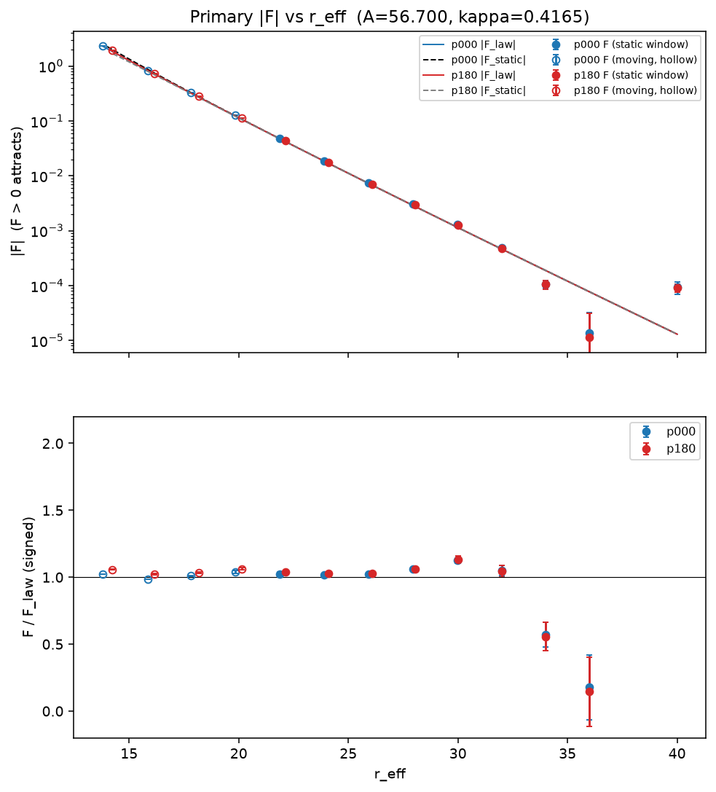
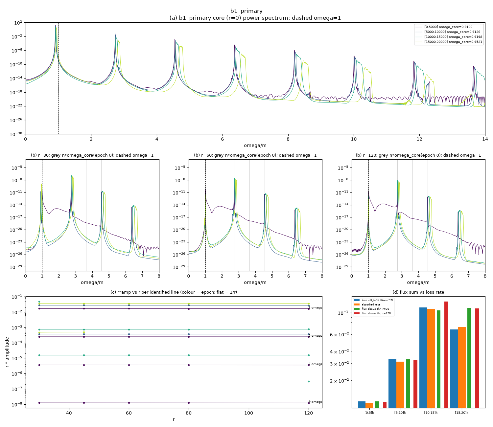

# Session 4 report

Date: 2026-11-09 to 2026-11-10. Plan: `SESSION_04_PLAN.md` (root), with Addendum 1 (12:05) and Addendum 2 (13:06), all committed before the results they govern were read. Resume file: `docs/SESSION_04_STATUS.md`. All compute ran on the Mac; nothing was pushed; no AWS.

**Inputs at the start.**
- `docs/SESSION_03_REPORT.md` exists and is complete. The Session 3 results lost to the AWS closure (3D spot checks, dip collisions, collision box and resolution checks, the beta = 5 distortions, P3 runs) are not inputs to either test here.
- `COMPUTE_GUIDELINES.md` does not exist in the folder; I followed `CLAUDE.md`'s compute section.
- `Swirl_Theory.txt` and the paper draft are not in this folder (the only paper is under the read-only `legacy/`); nothing touched them.
- `SexticEvolver` is the legacy engine class. The data come from its successors: `swirl/engine/evolver.py::Evolver` (3D) and `swirl/family/radial.py::Radial`. Test B derives the dispersion relation for all three.

**Where things are.**
- Test A: worktree `.claude/worktrees/s4-testA`, branch `s4-testA`; outputs `outputs/session4/testA/`.
- Test B: worktree `.claude/worktrees/s4-testB`, branch `s4-testB` (f85aca6); outputs `outputs/session4/testB/`; notes `docs/S4_TESTB_NOTES.md` in that worktree.
- Literature: `docs/PRIOR_ART.md`, "Session 4 brief" (U0 to U8, N39 to N44) and "Session 4, Test B against the literature" (V1 to V6, N45 to N49), "Session 4, Test A against the literature" (W0 to W8, claims 16 to 28, N50 to N55).
- Misses: `docs/FAILURES.md` F-030 to F-037.

## Verdict

**Test A: "decays to zero"** for the primary two-oscillon force, in phase and anti-phase. It is marginal on the formal rule and clear in the data.
- In phase attracts and anti-phase repels at every resolved separation. There is no minimum.
- The measured force follows the Yukawa tail law 2 pi A^2 cos(dtheta) e^(-kappa r)(kappa/r + 1/r^2) to 2 to 6% for r = 22 to 28 and 32, and 13% at r = 30 (a pass with a note). Fitted Yukawa k = 0.4231 +- 0.0041 in phase and 0.4265 +- 0.0043 anti-phase under A3', the deciding rule (A3 weights: 0.4173 +- 0.0022), against kappa = 0.41647.
- A constant (confining) force is excluded above about 3e-4 (3-s.e. bound: A3' 2.9e-4, A3 1.8e-4), 0.04% of the force at r = 16.
- Formal margin: the factor-100 fall clause is met only because r = 34 is resolved.
- Beyond r of about 34 a residual of about 1e-4 takes over, odd in the phase difference. It is consistent with (not shown to be) a 1/r term from the partner's 3 omega radiation; the 1/r law and the wavelength are model assumptions the 2-unit r grid cannot test. The plan named it in advance as a residual, not growth. A 1.33x box reproduces it at r = 34 and 40 within 2.2%, so box reflection is disfavoured; the 2x box of standard 4 was not run.
- **Unequal pair:**
  - Start 0: A3 undetermined, A3' decays. Start 180: undetermined under both. The reviewer reads the start-180 result as a tail-fit artefact (with the fitted constant set to zero it reads "decays"); that is a reading, not the rule.
  - Its beat amplitude is 7% to 21% below the static law on the momentum estimator at r 18 to 24, and the deficit grows with r (32% at r = 28, 53% at r = 36). The centroid estimator is biased lower still.
- **b5:** undetermined by point count. Every b5 point's V_F follows its own Yukawa law within 1.5% (F within 2.6%), with k = 0.2178 against kappa 0.2196.
- Under the deciding rule, 2 of the 5 force channels do not read "decays" (unequal start 180, b5); under A3, 3 do.
- Predictions: 3 hits (A-P3, A-P4 and the far-tail residual named in A3), 3 split (A-P1, A-P2, A-P6) and 2 misses (A-P5, A-P7). The misses are F-033 to F-037.

**Test B: emission only above threshold.** The lone beta = 4/3 oscillon radiates only at odd harmonics of its core frequency, all above the mass threshold m = 1, and nothing below m propagates.
- Threshold: m = 1 in all three solvers. The only shift is from RK4, at most 5e-8. Numerics and the reviewer derived this independently and agree.
- Core frequency: 0.9100 for the Session 1 primary (omega/m 0.910, about 0.09 below threshold) and 0.90684 for the long-lived dip start.
- Far field (r = 30 to 120): 3 omega, 5 omega, 7 omega and up, each falling exactly as 1/r. 3 omega carries 99.94% of the primary's emitted power.
- Below threshold: the only content is the fundamental's bound tail, which matches A e^(-kappa r)/r to 2 to 3% and is gone by r = 60 to 80.
- Energy balance: the flux in the harmonic lines equals the lump's measured loss rate to 0.971 to 1.003, in every epoch of both runs. This holds after an analysis defect was fixed; as first run, one epoch read 1.66.
- Robustness: both verdict criteria groups pass in every epoch, in a box twice the size and at half the grid spacing.

## 1. Test A: two-body potential V(r)

### 1.1 Verdict criteria as written before running (plan section 2, A3; Addendum 1, A3')

Copied from `SESSION_04_PLAN.md`, committed 7391c2d (A3) and d40e631 (A3'), before any production result was read.

**A3**, applied to each potential route and each channel:
- **"Decays to zero"** if all of:
  1. |V| falls by at least 100 between r_lo and r_hi and drops below 3 sigma_V somewhere;
  2. in fit L (V_inf + sigma r + C e^(-kr)/r), sigma is within 3 standard errors of zero, and its 3-s.e. bound is a constant force below 1% of |F(16)|;
  3. at least one decaying form (E1 e^(-kr), E2 e^(-kr)/r, G Gaussian, P power law) has reduced chi-squared at most 3.
- **"Grows"** if sigma has the confining sign at more than 5 s.e., |V(r_hi)| is resolved and not decreasing, and L beats every decaying form by Delta AIC > 10.
- **"Undetermined"** otherwise, including: fewer than two decades of resolved |V|; static and dynamical verdicts that disagree; a channel where no form reaches reduced chi-squared 3.
- Addendum 2 item 1 (written after production started, before any production result was read) made a static-dynamical disagreement "a finding, not a reason to read undetermined". Under A3 as first written, the primary would read "undetermined", because U_static is "undetermined" under A3 while V_F decays (section 1.4).
- **Form preference:** a form beats every other by Delta AIC > 10.
- **Named in advance as a residual, not growth or a form:** "a sign-alternating residual at the level of 1e-4 in force at r above 30 (possible radiation-mediated interference, wavenumber k3 = 2.54)".

**A3'** (Addendum 1, after A3 misfired on the exact static data):
- Weights sqrt(sigma_V^2 + (0.02 V)^2).
- r_lo = 16 decides (12 also reported).
- Clause 1 needs the fall of 100 and still falling over the last three points.
- Form preference only among E1, E2, G and P.

**Headline route** (Addendum 2, bac95eb, after production started and before any production result was read): V_F, the potential integrated from the measured force F = -(E_s/2) d'' of the lump separation d(t), for every channel. V_N (energy at fixed N), V_N_box, U_static (t = 0 overlap) and V_raw (raw t = 0 excess) are reported beside it.

**Dynamical window** (A0): t1 = 40 to t2 = min(400, run end - 1.5 periods, the time when kappa|d - r| reaches 0.10). A run with t2 - t1 < 35 is "moving" and stays out of the long-range fits. In practice:
- primary, r >= 28: 40 to 390;
- r = 22 to 26: 40 to 119 up to 40 to 319;
- r <= 20: moving.

### 1.2 Runs

Production: 118 jobs, 2026-11-09 12:24 to 2026-11-10 06:14, 4 workers, none failed (`outputs/session4/testA/logs/production.log`).
- dx = 0.55 and dt = 0.04 throughout, with an absorbing sponge.
- Each pair is built from the settled single-oscillon profile, and each box has its two settled singles as controls.

| Set | Lumps | Separations r | Channels | Box (cells, L) |
|---|---|---|---|---|
| Primary | beta 4/3, omega 0.909149, A 56.70, kappa 0.41647 | 7 to 14 (step 1), 16 to 36 (step 2), 40 | dtheta 0, 180 | 120 to 180, L 66 to 99 |
| Unequal | dip omega 0.90689 + big 0.85900 (N ratio 2.84, beat 131.6) | 10 to 14, 16 to 36 (step 2), 40 | start phase 0, 180 | 128 to 180 |
| b5 | beta 5, omega 0.9756, kappa 0.2196 | 24, 30, 36, 42, 48 | dtheta 0 | 200 to 240, L 110 to 132 |
| Controls | box 240 at r 24 (1.5x) and at r 34 and 40 (1.33x, both channels); dx 0.40 at r 16; linear twins at r 12 and 24 | | | |

**Linear twins** (g4 = g6 = 0) at r = 12 and 24: the field disperses. The energy left inside 3 hw at the end is 0.8% and 0.5% of the initial energy, so the binding seen in the nonlinear runs is nonlinear.

**Regime (standard 1):**
- Settled singles: omega/m = 0.90957, nonlinear energy share 0.148 (window mean), 0.350 at t = 0.
- Pairs at r >= 22 match the single's omega/m (0.9095704) to 1e-4. At r = 16 to 20 the differences reach 8.7e-4 (r = 16 anti-phase). The nonlinear share agrees to about 1e-3, and to 3e-4 for r >= 28.
- Pairs at r <= 14 are disturbed: omega/m reaches 0.87 to 1.05 as the lumps merge or fly apart.

**Controls:**
- Box: the 1.5x box at r = 24 changes F by 2.1e-5 (0.11%).
- Resolution: dx 0.40 at r = 16 gives F = 0.8209 against 0.8216 at dx 0.55 (0.08%).
- Box at the far tail (standard 4, added after the residual was seen): the four r = 34 and 40 rows rerun in a 1.33x box (production N = 180, L = 99; rerun N = 240, L = 132; same dx 0.55, t_end 400; `boxcheck_compare.json`). F changes by 0.8% to 2.2%, at most 0.11 of the L = 99 sigma_F. The sponge has no set radius in these jobs and defaults to the box edge (L/2), so it moves out from 49.5 to 66 with the box:

  | r | channel | F (L = 99) | F (L = 132) | F/F_law (L = 99) | F/F_law (L = 132) |
  |---|---|---|---|---|---|
  | 34 | 0 | 1.074e-4 +- 1.7e-5 | 1.088e-4 +- 1.4e-5 | 0.572 | 0.580 |
  | 34 | 180 | -1.045e-4 +- 2.0e-5 | -1.068e-4 +- 1.5e-5 | 0.557 | 0.569 |
  | 40 | 0 | 9.34e-5 +- 2.4e-5 | 9.41e-5 +- 1.2e-5 | 7.19 | 7.24 |
  | 40 | 180 | -9.00e-5 +- 1.5e-5 | -9.12e-5 +- 1.4e-5 | 6.93 | 7.03 |

  The far-tail force does not move with the box, which disfavours a boundary effect. Standard 4 asks for a box twice the size; 1.33x is what fitted the remaining time, and the 2x check is in the parking lot. The L = 132 sigma reuses the L = 99 singles' noise floor (no new singles were run), so its smaller size is sampling, not a gain.

**Analytic or t = 0 value first (standard 6):** the engine's t = 0 cross energy against an independent quadrature of the Yukawa tail is 8.527 against 7.757 at r = 20 and 2.228 against 1.533 at r = 24. A quadrature of the measured profile reproduces the engine to 4e-4; the surplus is the non-evanescent 3 omega cloud of the profile (`diag_surplus.json`).

**Excluded from the force route** (analysis fix 7fc8e9e, one attempt; the reviewer confirms):
- The 24 near-overlap rows: primary r 7 to 13, unequal r 10 to 14, both channels.
- The lumps move by more than kappa|d - r| = 0.1 before the smoothed separation series starts (1.5 periods), so the window holds one sample.
- The raw separations still show the sign of the force:
  - primary in phase at r = 7: d goes 6.8, 5.3, 2.9 at t = 0, 10, 20 (they merge);
  - anti-phase at r = 7: 8.1, 9.5, 12.1 (they fly apart).

### 1.3 Results

**Primary force** (`outputs/session4/testA/analysis.json`, `outputs/session4/testA/plots/1_primary_force.png`, `plots/TABLES.md`).

F > 0 attracts. F_law = 2 pi A^2 cos(dtheta) e^(-kappa r)(kappa/r + 1/r^2), the analytic Yukawa law. Below r_eff = 21 the full-overlap static force differs from F_law; the ratio to it is given in brackets.

| r_eff | F (in phase) | F/F_law | F (anti-phase) | F/F_law | Note |
|---|---|---|---|---|---|
| 13.8 / 14.2 | +2.356 | 1.02 (0.93) | -1.957 | 1.06 (1.15) | moving; reviewer: s.e. understated, F not trustworthy |
| 15.8 / 16.2 | +0.8216 | 0.985 (0.94) | -0.7297 | 1.02 (1.06) | moving |
| 17.8 / 18.2 | +0.3240 | 1.01 (0.99) | -0.2786 | 1.03 (1.05) | moving |
| 19.9 / 20.2 | +0.1268 | 1.04 (1.03) | -0.1126 | 1.06 (1.07) | moving (by 1.6 and 0.6 time units) |
| 21.9 / 22.1 | +4.804e-2 | 1.02 | -4.377e-2 | 1.04 | |
| 23.9 / 24.1 | +1.874e-2 | 1.02 | -1.729e-2 | 1.03 | |
| 25.9 / 26.1 | +7.465e-3 | 1.02 | -6.925e-3 | 1.03 | |
| 28.0 | +3.043e-3 | 1.06 | -2.935e-3 | 1.06 | |
| 30.0 | +1.286e-3 | 1.13 | -1.276e-3 | 1.13 | |
| 32.0 | +4.84e-4 | 1.05 | -4.81e-4 | 1.05 | |
| 34.0 | +1.07e-4 | 0.57 | -1.04e-4 | 0.56 | |
| 36.0 | +1.4e-5 | 0.18 | -1.1e-5 | 0.15 | unresolved (< 3 sigma) |
| 40.0 | +9.3e-5 | 7.2 | -9.0e-5 | 6.9 | |

Typical sigma_F is 2e-5 at r >= 28.

**Signs:**
- In phase: attractive at every resolved r. Anti-phase: repulsive at every resolved r. The near-overlap motion shows the same signs at r 7 to 13.
- No minimum in either channel, static or dynamical. The only static sign change is a maximum of the anti-phase U at r = 6.4, inside the overlap region.

**Primary potential** (`plots/2_primary_potential.png`):
- V_F/U_law is 1.02 to 1.04 for r 22 to 28, then 0.96, 0.77 (sigma 0.09), 0.69 (0.19), 1.16 (0.43) and 1.17 (1.6) at r 30, 32, 34, 36 and 40. The last points are dominated by the tail extrapolation.
- V_N resolves only near r = 20 to 22. In phase it is 0.71 +- 0.04 of U_law at r = 20; anti-phase it is 1.37 +- 0.10. In phase, beyond r = 24 its error is comparable to its value (2.4 sigma at r = 26, 0.6 at 28). Anti-phase it stays significant (V_N 5.3 to 6.6 sigma at r 24 to 26; V_N_box 12, 8.1, 8.1 and 4.6 sigma at r 24 to 30) but at 2.5 to 7.7 times U_tail: an offset, not a noise floor.
- U_static/U_law is 1.106 at r 12, 1.022 at 16 and 1.001 at 24.
- V_raw has the opposite sign to U, and |V_raw/U| tends to 1.985 r - 8.0.

**Fits** to V_F, primary, over r 22 to 34 (7 points; reduced chi-squared, in phase / anti-phase):

| Form | A3 | A3' | fitted k (A3 weights) |
|---|---|---|---|
| E1 C e^(-kr) | 2.40 / 2.76 | 1.75 / 2.07 | 0.458 / 0.460 |
| E2 C e^(-kr)/r (Yukawa) | 3.32 / 3.68 | 2.29 / 2.62 | 0.4173 +- 0.0022 / 0.420 |
| G Gaussian | 14.6 / 13.1 | 3.7 / 3.0 | |
| P power law | 36.9 / 35.8 | 17.0 / 16.7 | |
| L V_inf + sigma r + C e^(-kr)/r | 0.75 / 0.85 | | 0.406 / 0.409 |

Fit L's constant force is sigma = -3.3e-5 +- 5.0e-5 in phase and +2.9e-5 +- 5.0e-5 anti-phase (A3), and -7.3e-5 +- 7.1e-5 and +7.4e-5 +- 7.2e-5 (A3'). Its 3-s.e. bound is 1.8e-4 (A3) and 2.9e-4 (A3'), at most 0.036% of F(16) = 0.78.

Under A3' the fitted Yukawa k is 0.4231 +- 0.0041 in phase and 0.4265 +- 0.0043 anti-phase (the anti-phase value is 0.0100 above kappa, at the edge of A-P1's +-0.01); k_E1 is 0.462 and 0.465; E1 leads E2 by Delta AIC 2.7 and 2.75.

**Unequal pair** (`plots/3_unequal_force.png`):
- The force oscillates with the measured relative phase at the beat. Phase lag at most 0.02 rad; no cos 2dphi term.
- The centroid force amplitude is 0.62, 0.56, 0.50 and 0.455 of the static law at r = 18, 20, 22 and 24, then a plateau of 0.42 to 0.44 for r = 26 to 36. Both start phases give the same values.
- The ball-momentum estimator gives 0.93, 0.89, 0.84 and 0.79 at r = 18 to 24, then 0.74, 0.68, 0.62, 0.56, 0.51 and 0.47 at r = 26 to 36. On that estimator the deficit grows with r.
- Fitted k (centroid): 0.440 and 0.442 over r >= 26, a range chosen after the plateau was seen; 0.489 and 0.495 over r >= 18. Static law: 0.436 to 0.449 (0.443 and 0.446 over r >= 18); kappa_min 0.4214. The registered V_F E2 k is 0.471 to 0.475 (start 0) and 0.505 to 0.519 (start 180).
- At r >= 26 the forces on the two lumps split (F1/F2 from 0.91 down to 0.39).
- The mean (rectified) force is repulsive and second order.

**b5** (`plots/4_b5_force.png`):
- V_F/U_law = 0.985, 0.995, 1.000 and 1.014 at r 30, 36, 42 and 48. F/F_law = 0.974, 0.988, 0.9965 and 0.9915 (F/F_static 0.92 to 0.99 at r <= 42; r = 48 is clamped at the 45 grid end).
- Tail-fit k = 0.2178 +- 0.0003 against kappa 0.2196, chi2 0.85 on 2 dof.
- Only 4 rows are resolved, and r = 24 is moving.

### 1.4 Verdicts

| Channel | Route | A3 | A3' (decides) | U_static (A3') |
|---|---|---|---|---|
| Primary, in phase | V_F | decays to zero | decays to zero | decays to zero |
| Primary, anti-phase | V_F | decays to zero | decays to zero | decays to zero |
| Unequal, start 0 | V_F (amplitude) | undetermined | decays to zero | decays to zero |
| Unequal, start 180 | V_F (amplitude) | undetermined | undetermined | decays to zero |
| b5, in phase | V_F | undetermined | undetermined | decays to zero |
| All channels | V_N, V_N_box | undetermined | undetermined | |

Notes on the table:
- U_static under A3 is "undetermined" everywhere. That is the known misfire on exact data (chi-squared about 1e17 with sigma about 1e-8) that A3' was written for.
- A3 calls the primary V_F "decays" and U_static "undetermined", and the code flags the disagreement. Under A3', the deciding rule, the two agree.
- The unequal start-0 channel fails A3 because fit L's sigma is 3.3 s.e. (between the 3 and 5 thresholds) and no form reaches chi-squared 3. E2 is 4.64.
- The unequal start-180 "undetermined" is an artefact, per the reviewer. The tail fit accepted a constant force of 1.1e-4 at 5.5 s.e., which cut the resolved range to r <= 26 (fall 94 < 100). With that term at zero the channel reads like start 0 (A3' decays, E2 chi-squared 1.63). It is reported as computed.
- b5 is "undetermined" by point count (4 resolved points, the rule needs 5), not by the data's shape.

**Test A verdict: "decays to zero"** for the primary pair in both phase channels, under A3 and A3'. It is marginal on the formal rule: the factor-100 fall reaches r_hi = 34 only because r = 34 is resolved. Dropping r >= 34 gives a fall of 90 and 84, which is "undetermined". The physical evidence is not marginal:
- F falls from 0.78 at r = 16 to about 1e-4 at r = 34.
- It tracks the Yukawa law to 2 to 6% over r 22 to 28 and 32, 13% at r = 30.
- A constant (confining) force is excluded above about 3e-4 (A3' 2.9e-4; A3 1.8e-4).
- No form other than decaying ones fits.

The unequal channel agrees in kind under A3'. b5 is undetermined by count, while every b5 point's V_F follows its own Yukawa law within 1.5% (F within 2.6%).

**Functional form:** no form is preferred by the rule (Delta AIC > 10). E1 leads E2 by 4.6 in chi-squared under A3 and by Delta AIC 2.7 under A3'. Fitted k_E2 = 0.4231 +- 0.0041 and 0.4265 +- 0.0043 (A3'; A3 0.4173 +- 0.0022) against kappa = 0.41647.

### 1.5 Reviewer's independent check

The reviewer used its own code on the raw results, in `scratchpad/reviewer_A/`, and accepts the bookkeeping.

**Bookkeeping:**
- Whole-period E and E_box agree to 2e-12, omega to 5e-10, and N to 8e-5 (3e-4 on short windows).
- V_N and V_N_box agree to 7e-5, where sigma_VN >= 8e-3.
- The control floor is exact.
- F agrees to 3e-10 on all 26 force rows. An independent raw-separation fit with omega and 2 omega harmonics agrees within 0.5 sigma_F for r >= 20.
- An inertia-free momentum route gives F_P/F = 0.98 to 1.00, so using E_s as the inertia is right to about 0.2%.

**Exclusions:**
- The 24 excluded rows are confirmed.
- The pA_r14 rows (moving, not in any fit) have an understated s.e. Their F differs by 3.6% and 5.7% on another estimator.

**Verdicts:**
- All five channels were reproduced with its own fit code.
- Primary "decays" is accepted with the marginality above.
- Unequal start 180 "undetermined" is accepted as computed but not as informative (artefact above).
- b5 "undetermined" is accepted as a count result.

**Far tail:** sigma_F is credible as noise. The p000 + p180 sums at r 34 to 40 are 2.4e-6 to 3.4e-6, against sigma_F 2e-5. The 1e-4 departure is not noise:
- it is mirrored in sign by an independent run;
- the momentum and raw-separation estimators reproduce it;
- it is steady between window halves.

**Unequal:** no normalisation error (reduced mass, factor 2, kappa) was found. The centroid estimator is contaminated by beat-phased interference energy crossing the mid-plane. That is the right order at r 22 to 28 and too small at 34. The momentum estimator is reciprocal for r <= 24, and the reviewer treats its values as the cleaner reading.

**Defects found, none changing a verdict:**
- the unequal F16 uses `np.interp`, which clamps (analysis.py:1039; the 1% bound is 3x too strict);
- the V_F sigma omits the tail-fit uncertainty;
- the window fallback can start before the smoothed series (open, left as is).

**Final read of this report (reviewer, 2026-11-10):** first pass FAIL on text, with no wrong verdict and no upgrade. 20 corrections were applied, among them:
- the far-tail box check is 1.33x, not 1.5x, so box reflection is "disfavoured", not "ruled out";
- the A3' fit numbers (k, constant-force bound) now stand beside the A3 ones;
- A3 is quoted in full, with the clause Addendum 2 removed;
- the far-tail 1/r law and wavelength are stated as model assumptions;
- F-035 and F-036 now carry ranked causes and the growing deficit on the momentum estimator;
- the F/F_law column below r = 21 now uses the analytic law.

### 1.6 Literature comparison (scholar)

`docs/PRIOR_ART.md`, "Session 4, Test A against the literature" (W0 to W8, claims 16 to 28, notes N50 to N55, searches 257 to 277).

**Agrees:**
- signs, no minimum, exponential decay with kappa = sqrt(1 - omega^2), and no confinement for a massive field (Malomed 1998; Bowcock et al. 2009; Kevrekidis et al. 2004; Campos et al. 2026; Amin & Mou 2020; Xue et al. 2025);
- the unequal pair's force oscillating at the beat (Axenides et al. 2000; Bowcock eq. 4.7; Campos eq. IV.11; Siemonsen & East eq. 7);
- the unequal decay constant.

**Disagrees:**
- The unequal amplitude on the cleaner estimator (7% to 26% low at r 18 to 26). The literature expects convention dependence and a weak higher-order mean force (Bowcock), but quantifies neither for 3D lumps.

**Untested:**
- **The far-tail 1/r term.** No source found for a radiation-mediated, distance-oscillating force between oscillons, breathers, Q-balls or kinks (nine searches). Analogues exist in optical binding (Forbes et al.), collective atomic decay and the dipole-dipole shift (Ficek & Tanas), and optical solitons interacting through radiation (Yulin et al. 2013; Sakaguchi, Skryabin and Malomed 2018).
- "E2 preferred" (a rule, not a source).
- The V_N floor.
- b5's number.

**Novelty:** nothing in Test A is new in kind. The far-tail term may be described as "no source found for oscillons; the oscillon counterpart of optical-binding and resonance-interaction physics". Not "first" or "new".

### 1.7 Predictions on record, scored

| # | Prediction | Measured | Score |
|---|---|---|---|
| A-P1 | Every dynamical channel decays; E2 preferred; k = 0.4165 +- 0.01 (b5 within 5% of 0.2196) | Primary decays (marginal); unequal start 0 decays (A3'), start 180 undetermined; b5 undetermined by count. E2 not preferred (E1 by 4.6). k_E2 = 0.4173; b5 k = 0.2178 (0.8%) | **Hit** on k (both points; A3' anti-phase at the +-0.01 edge). **Miss** on "every channel decays": 2 of 5 channels undetermined under A3' (unequal start 180, b5), 3 under A3. **Miss** on "E2 preferred" (F-033, F-037) |
| A-P2 | V_N and V_F within 10% of U_tail for r >= 12; below it inside 12 | F within 2 to 6% of F_law for r 22 to 28 and 32, 13% at r = 30. V_F/U_law 1.02 to 1.04 to r = 28, 0.96 at 30, 0.77 +- 0.09 at 32 (moving rows 14 to 20: -1.5% to +6.4% against F_law). Beyond r = 34 the force departs by about 1e-4 (ratios 0.57, 0.18, 7). V_N 0.71 / 1.37 at r = 20. Static exceeds U_tail inside 12 (recorded before production, Addendum 1 item 5) | **Hit** to r = 28; pass with a note at r = 30 (F, 1.3x the band) and r = 32 (V_F, 2.3x). **Miss** beyond 34 (F-034) and for V_N (F-036). **Miss** inside 12 (pre-recorded) |
| A-P3 | Attractive in phase, repulsive anti-phase at every resolved r; no minimum for r >= 7 | As predicted, including the near-overlap motion | **Hit** |
| A-P4 | V_raw opposite sign to U_static, |V_raw/U| about 2r, decays | Opposite sign; 1.985 r - 8.0; A3' decays | **Hit** (leading order only, as before) |
| A-P5 | U_static and V_N agree within 10% for r >= 12; the PDE adds no new long-range term | V_N 0.71 / 1.37 of U at r = 20 (3 omega cloud systematic, Addendum 2). The PDE does add a far-tail term (F-034) | **Miss** on both clauses |
| A-P6 | Unequal amplitude within 15% of the Session 3 law for r >= 12, oscillating at Delta omega; long-range k tends to kappa_min | Oscillates at the beat. Amplitude 0.42 to 0.62 (centroid), 0.93 to 0.74 (momentum, r 18 to 26; 0.47 at r = 36); k = 0.440 against static 0.436 to 0.449, kappa_min 0.4214 | **Hit** on the oscillation. On the momentum estimator: within the band to r = 20, pass with a note at r 22 to 26 (1.1 to 1.7x the band), miss from r of about 28 and beyond 3x from r of about 34; the centroid is beyond 3x from r = 22 (F-035). **Partial** on k (follows the static law, not kappa_min) |
| A-P7 | V_N floor reached at r 28 to 34 | U_tail falls below 3 sigma_VN (about 0.05) at r of about 23; sigma_VN is 0.015 to 0.019, 8 to 10x the planned 1.8e-3 | **Miss** (F-036) |
| A3 note | 1e-4 sign-alternating residual above r = 30, k3 = 2.54, possible | Present, about 1e-4, odd in dtheta | **Hit** in kind (see 1.8) |

Literature expectations for each row, with sources, are in `docs/PRIOR_ART.md` W2 (Test A) and V2 (Test B); the plan's tables carry the same column.

### 1.8 Misses: expected, measured, causes, diagnostics

Full entries are in `docs/FAILURES.md`, F-033 to F-037. The three cheap diagnostics per miss are in `diag_production.json` (code 71c7d9e, data 8471853, branch `worktree-agent-a6c4107736c741b0a`), corrected by the reviewer where they differ.

**F-034, far tail (A-P2 beyond r = 34; A-P5's "no new long-range term")**
- Expected: Yukawa within 10%.
- Measured: a residual F - F_static of about +1.5e-4 at r 26 to 30, then +2e-5, -8e-5, -6e-5 and +8e-5 at r 32, 34, 36 and 40. It is odd under dtheta -> dtheta + 180 (the channel sums are under 3.4e-6).
- Candidates, ranked: (a) the partner's 3 omega radiation; (b) box reflection; (c) error model or a t = 0 transient.
- Diagnostics run:
  - **D1 (model comparison):** the best model is a +3.4% +- 0.4% baseline plus B sin(k3 r + delta)/r, chi2 2.2 on 14 points. Constant per box: chi2 99. Zero: 271.
  - **D2 (estimator and window):**
    - window halves and t1 = 120 reproduce the residual (12 z-values, largest 1.19);
    - the momentum estimator agrees;
    - no common-mode drift.
  - **D3 (first-order theory):** F3 = (k3 Q^2/(8 pi r)) sin(k3 r - 3 dtheta), with Q from the 3 omega source of the profile. The reviewer re-derived it independently; the Born amplitude B0 is 3.85e-3, about 1e-4 at r = 30 to 40. The formula was derived after the residual was seen.
- Result:
  - **Ruled out:** (c). The quoted sigma_F is conservative (chi2_red 0.20 for the best model).
  - **Disfavoured:** (b). The box-180 constant is -1.0e-5 +- 0.7e-5, and the 1.33x box rerun at r = 34 and 40 changes F by 0.8% to 2.2% (at most 0.11 sigma; section 1.2, Controls). The 2x box of standard 4 was not run.
  - **Supported, with limits:** (a).
    - The fitted amplitude is 0.84 of Born, with a phase offset of 0.5 to 0.6 rad. With Born amplitude and no offset, chi2 is 42.6 on the 8 points at r >= 32.
    - The 2-unit r grid cannot tell k3 = 2.54 from its alias 0.60; a free-k scan prefers the alias (chi2 0.45 against 2.2). 3 omega is chosen because 2, 5 and 7 omega are excluded (chi2 140 to 155) and Test B shows no line at the alias frequency.
    - The 1/r amplitude law is only weakly preferred: chi2 2.2 against 4.8 (r^0) and 4.2 (1/r^2) on 11 dof (reviewer's refit).
    - The +3.4% baseline is unexplained. The settled-omega shift of the profile predicts only 0.6% to 1.9%. At r 26 to 30 the residual is mostly that baseline, so the 3 omega reading rests on r >= 32.
- Status: "3 omega-type radiation interference, consistent, partly confirmed".
- What it rules in: a force component of about 1e-4 at r >= 32, odd in the phase difference, consistent with (not shown to be) a 1/r term from the partner's 3 omega radiation. The 1/r law, the wavelength 2.48 and the sign-change spacing are model assumptions the 2-unit grid cannot test. In the data it is 0.43, 0.82 and 6.2 times the Yukawa law at r = 34, 36 and 40 (the fitted model crosses it at 34.7). It changes sign across the grid and shows no confining sign.
- What it rules out: a constant (string-like) force, which is excluded above about 3e-4; fit noise. It disfavours a box artefact (the 1.33x box reproduces it).
- Expensive, proposed:
  - pairs at r = 30.0, 30.6, 31.2 and 31.9 (quarter-wavelength steps);
  - a run with the k3 band filtered outside the lumps;
  - dtheta = 60 degrees (3 dtheta = 180, so the term flips relative to the Yukawa);
  - the static baseline recomputed at the settled omega;
  - the 2x box at r = 34 and 40 (standard 4).

**F-035, unequal amplitude (A-P6)**
- Expected: within 15% of the Session 3 static law.
- Measured: 0.62 to 0.42 on the centroid estimator; 0.93 to 0.47 on the momentum estimator (r 18 to 36).
- Diagnostics run:
  - normalisation rebuilt from moments: exact, no factor-2 or reduced-mass error;
  - phase-lag and cos 2dphi columns: null;
  - a per-lump estimator comparison: centroid against ball momentum differ by 0.57 to 0.93 for unequal lumps, but agree to under 1% for equal lumps.
- Ranked causes (ledger): (1) centroid dressing; (2) a real but modest deficit on the momentum route, cause not identified; (3) the forces on the two lumps splitting at r >= 26 (F1/F2 0.91 down to 0.39).
- Cause (1), per the reviewer: at a constant beat frequency, interference energy oscillating across the mid-plane in phase with cos dphi shifts the centroids exactly like a force at the beat. The centroid amplitude is a biased lower bound. The momentum estimator is reciprocal up to r = 24 and reads 0.93, 0.89, 0.84 and 0.79 at r = 18 to 24.
- The numerics' inverse-mass reweighting explanation is not relied on (the reviewer: a single-potential model gives equal and opposite forces).
- What it rules in: an amplitude deficit of about 7% to 21% at r 18 to 24 on the cleaner estimator, growing with r (32% at r = 28, 53% at r = 36; about -0.046 per unit r in log ratio). The decay rate is not the static law's: k over r >= 18 is 0.489 and 0.495 against 0.443 and 0.446. Only the centroid fit over r >= 26, a range chosen after the plateau was seen, matches it.
- What it rules out: a normalisation error and a phase lag.
- Expensive, proposed: a second unequal pair with a different beat frequency at r 24 and 30. A real force is independent of Delta omega; the centroid dressing gives an apparent force proportional to Delta omega^2.

**F-036, V_N floor (A-P7)**
- Expected: r 28 to 34, with a floor of about 1.8e-3. Measured: U_tail falls below 3 sigma_VN (about 0.05) at r of about 23; sigma_VN is 0.015 to 0.019 at r 22 to 28, 8 to 10 times the plan's floor. V_N sits above U by +0.07 (in phase) and +0.09 (anti-phase) at r = 20.
- Ranked causes (ledger): (1) interference energy of the two lumps' coherent 3 omega clouds over the box, falling as 1/d, slower than U_tail (scholar's estimate N51: 0.010 to 0.016 at d = 20); (2) the plan's floor came from isolated singles and has no coherent term; (3) a local cloud-times-core coupling.
- Diagnostics run: the t = 0 cross-energy surplus (`diag_surplus.json`, after production started and before any production result was read; Addendum 2) is 0.71 at r = 20, 0.70 at 24 and 0.94 at 16. The measured offset is about a tenth of that, so most of the t = 0 surplus is compensated. V_N against V_N_box. N51 supports cause (1) in kind but is 5 to 9 times smaller than the offset. Unresolved in size.
- Rules in: V_N is limited by a radiation term of the lumps that V_F avoids to r = 34. Rules out: reading V_N as an interaction energy beyond r of about 22.
- Proposed (cheap to moderate): a dip pair at r 22 to 28, where the 3 omega power is 1/2007 of the primary's and the offset should vanish (D-A2); V_N at two box sizes at the same d, where the offset should grow with L (D-A6); the sinc form from the stored single-lump fields (D-A4).

**F-033, "E2 preferred" (A-P1)**
- The clause asks for a discrimination that 7 points over r 22 to 34 cannot make. E1's k (0.458) is what a Yukawa returns when fitted as a pure exponential, kappa + 1/r_mid.
- Not explained: exact Yukawa data with these weights would give a chi-squared difference of 0.2 to 0.6 (N53). The measured 4.6 leans to E1 by about 4 units beyond the weights. Untested candidate: the far-tail term entering the integrated V_F.
- The rule's Delta AIC > 10 against L was out of reach by construction (recorded in Addendum 1 item 2).

**F-037, b5 undetermined**
- Four resolved rows against the rule's five. The b5 grid had 5 separations, one of them moving. A design miss, not a physics one.
- The fitted k is 0.8% below kappa, which is 6 quoted standard errors. The cause is not identified (the settled omega equals the static one to 5e-6).

## 2. Test B: radiation spectrum of the lone oscillon

### 2.1 Verdict criteria as written before running (plan section 3, B4)

- **"Emission only above threshold"** if all of:
  1. at every probe with r >= 30, the power below omega_th - delta (delta = 3 resolution bins) is at most 10 times the larger of the leakage floor and the evanescent floor, or below 1e-4 of the total power there;
  2. any sub-threshold line falls with r faster than 1/r across the far probes (a fitted exponent steeper than -1.3, or consistent with e^(-kappa r)/r);
  3. the outgoing flux in lines above threshold accounts for the measured loss rate within a factor 3.
- **"Sub-threshold emission present"** if a line at omega_s < omega_th - delta appears at two or more probes with r >= 30, at least 10 times both floors, with amplitude falling as r^-1 (exponent -1 +- 0.3) and reproduced in the doubled box. Or if the above-threshold flux falls short of the loss rate by more than 3 times and a sub-threshold line carries the difference.
- **"Undetermined"** otherwise.

The numerics worker documented four readings of these criteria before the production runs (`docs/S4_TESTB_NOTES.md` section 5). The reviewer found none of them favourable to "only above" beyond what B4 licenses (section 2.6).

### 2.2 Dispersion relation and threshold, from the code (B1)

Linear frequency Omega^2 = m^2 + K^2(k), with V''(0) = m^2 checked in all three implemented potentials (force to 1e-8 by finite differences).

| Solver | K^2(k) as implemented | Threshold omega_th - m (production dt) | Deviation from sqrt(k^2 + 1) at k3 = 2.54 |
|---|---|---|---|
| `SexticEvolver` (legacy, N = 64, L = 50, dt 0.05) | k^2 + sigma (k dx)^4, sigma = 0.01: a conservative stiffness on phi, subtracted in the acceleration | -5.2e-8 | +1.03e-2 (+3.4e-2 at k5); group velocity at 5 omega is 1.07, superluminal, a stiffness artefact |
| `Evolver` (v2, spectral, dt 0.04) | k^2 exactly, Nyquist included | -2.1e-8 | RK4 phase only, -1.2e-6 |
| `Radial` (4th-order FD in u = r phi, dr 0.05, dt 0.0125) | k^2 [1 - (k dr)^4/90] | -2.0e-10 | -1.24e-6 |

- The RK4 frequency is Omega (1 - (Omega dt)^4/120). It is the only thing that moves the threshold.
- No linear mechanism lets energy propagate below m in any solver. The operator spectrum is at least m^2, and every damping term is a non-negative operator on phi_t. The radial sponge has two strongly damped modes with Re omega below m (0.937 and 0.985, decay time about 2.5) near the outer wall. They are damped, not propagating.
- In the data, the 5 omega and 7 omega wavenumbers measured across the probes match the radial stencil's dispersion to 1e-8, which resolves the stencil's own shift (reviewer).
- Agreement: numerics (`docs/S4_TESTB_NOTES.md` section 1) and the reviewer (independent, written before reading numerics' notes) agree to 3 digits or better on every number. The reviewer adds the legacy superluminal group velocity and the sponge's damped sub-m modes; neither affects Test B.
- **The B1 stop condition did not fire.**

### 2.3 Runs

Radial solver, beta = 4/3, R_sponge 200, R_box 400, sigma 1 (quadratic profile); probes at r = 0, 10, 15, 20, 30, 45, 60, 80, 120 every 0.2 time units. Initial data are the single-frequency profile with phi_t = 0, as in Session 1. No stored Session 1 to 3 series had far-field probes, so every run is new. Total wall time 14 minutes.

| Run | Start | T | Purpose |
|---|---|---|---|
| b1_primary | omega 0.909149 (Session 1 primary) | 20,000 | the requested run |
| b2_dip | omega 0.9065045 (Session 2 long-lived start) | 20,000 | the point where the 3 omega source nearly vanishes |
| b1_linear | b1 with g4 = g6 = 0 | 20,000 | linear twin (standard 5) |
| b1_box2, b2_box2 | doubled box (R_s 400, R_box 800) | 20,000 | standard 4. Extended from 5,000 and added for the dip by me before production |
| b1_half_dr | dr 0.025, dt 0.00625 | 2,000 | resolution |

**Regime (standard 1).**
- Primary: omega/m 0.910 at the start, rising to 0.948 by the last epoch. Signed nonlinear share -0.316 at t = 0, epoch means -0.130, -0.126, -0.113 and -0.074.
- Dip: omega/m 0.9068, steady. Nonlinear share -0.323 at t = 0 and -0.134 on average.
- The primary is near the end of its life: E inside 3 hw is 0.597 of E0 at t = 20,000, and the radial primary died at 22,932 in Session 3.
- Energy check: the radial "absorbed" is defined as E_h(0) - E_h, so "E + absorbed" is an identity there (reviewer). The real check is that the discrete energy never rises; its largest rise is 2.4e-10 of E0.

### 2.4 Results

Spectra: Hann windows of 2,000 time units with 50% overlap (resolution 0.0031), in four epochs of 5,000 units. Plots: `outputs/session4/testB/b1_primary_testB_plots.png` and `b2_dip_testB_plots.png`.

**Core frequency, by epoch.**

| Epoch | Primary, Welch peak (bracket: r = 30 line centroid where it differs) | Dip |
|---|---|---|
| [0, 5k] | 0.91005 (0.9101) | 0.906836 |
| [5k, 10k] | 0.91262 | 0.906837 |
| [10k, 15k] | 0.91980 | 0.906838 |
| [15k, 20k] | 0.95214 (0.948) | 0.906839 |

**Far-field lines** (r times amplitude, constant for a 1/r wave; exponent fitted over r = 30 to 120):

| Line | Primary, epoch 0 | Exponent | Dip | Exponent |
|---|---|---|---|---|
| 3 omega | 0.0167 | -1.006 | 3.74e-4 | -1.000 |
| 5 omega | 2.49e-4 | -1.003 | 1.575e-4 | -1.000 |
| 7 omega | 3.6e-6 | -1.005 | 1.97e-6 | -1.000 |
| 9 omega | 1.26e-8 | -1.010 | 2.9e-8 | -1.000 |
| 11 omega to 15 omega | 4.5e-10 (11 omega) | -0.97 | 5.4e-10, 1.0e-11, 1.9e-13 | -1.000 |

- **Odd harmonics only**, at the core and in the far field. No even line rises above the floor anywhere; at r = 0 they are at most 4.4e-9, against a fundamental of 5.15.
- **No fundamental propagates.** The fundamental appears at far probes only as its bound tail. Measured over the predicted A e^(-kappa r)/r, it is 0.98 at r = 30 and 0.97 at r = 45. The fitted decay constant is 0.4214 against 0.4215 at the dip, and 0.4144 against 0.4145 at the primary. The tail is gone by r = 80 (r = 60 at the primary's last epoch, where kappa is 0.306).
- **At the dip, 3 omega is suppressed.** Its flux is 1/2007 of the primary's, and 5 omega carries 34% of the dip's flux, against 0.065% at the primary. 3 omega is still the dip's largest line, with 66% of the flux.
- **Near threshold** (1.0004 to 1.0077): a band at the far probes that chirps toward 1 from above, following the Klein-Gordon local frequency m t/sqrt(t^2 - r^2) (1.0484 against 1.0483 predicted at r = 120, t = 400). It is the transient shed by the phi_t = 0 start, and it never goes below 1 within the 0.016 resolution of the short windows.
- **Sidebands** at n omega +- 0.095, on the dip's 3 omega and 9 omega lines (and, more weakly, the primary's), 1e-5 to 2e-3 of their line. Diagnostic D-B2 shows they are not a shape mode of the lump: they are mixing products with the near-threshold field that slow waves bring back from the sponge region, and their offset depends on the box (section 2.7). They lie above threshold.

**Below threshold** (criterion 1; worst ratio over every far probe and epoch):

| Run | Worst sub-threshold power over the floor | Where | What it is |
|---|---|---|---|
| Primary | 1.04 | r = 30, epoch [10k, 15k] | the bound fundamental tail, which is the evanescent floor itself |
| Dip | 1.02 | r = 30, every epoch | the same |
| Both, r >= 45 | at most 0.78 | | at the leakage floor. The reviewer's own estimator puts the true content 2 to 4 orders below the code's floor |
| Linear twin | at most 0.51 | | the same order as the nonlinear runs, so the twin does not separate anything finer than the floor |

No sub-threshold group falls slower than e^(-kappa r)/r (criterion 2). The dip's only group is its bound tail, with a fitted exponent bound of -16.6 against the required -1.3.

**Energy balance** (criterion 3; harmonic-line flux over the loss rate, both Hann^2-weighted; after the fix in section 2.6):

| Epoch | Primary, r = 30 / 120 | Dip, r = 30 / 120 |
|---|---|---|
| [0, 5k] | 0.996 / 0.980 | 0.997 / 0.997 harmonics only (1.005 / 1.40 with the start-transient band included) |
| [5k, 10k] | 0.993 / 0.971 | 0.997 / 0.997 |
| [10k, 15k] | 0.992 / 0.977 | 0.997 / 0.997 |
| [15k, 20k] | 0.971 / 1.003 | 0.997 / 0.996 |

- Loss rates in energy per unit time: primary 0.0122, 0.0332, 0.114, 0.067; dip 9.2e-6 to 9.8e-6 (3.1e-9 to 3.3e-9 per unit time as a fraction of E, matching Session 2's 3.3e-9).
- The total spectral flux equals -dE_in(r)/dt at the same r to 0.99995 to 1.00013 (primary) and 0.997 (dip). That is energy conservation seen through the windows. What tests physics is the split: the flux below threshold, over the loss, is below 1e-6.

**Controls.**
- Doubled box: verdict "only above" in every epoch; the same omega_core to 5 digits; losses to 4 digits. The far-probe series differ by 0.2 to 0.4% (relative maximum), entirely in the near-threshold band, which depends on the box (section 2.7).
- Half dr: probes agree to 2.1e-4 or better; verdict the same.
- Linear twin: disperses. Its verdict reads "Undetermined" only because criterion 3 has no meaning without a lump; criteria 1 and 2 pass.

### 2.5 Verdict

**"Emission only above threshold"** at both points, in every epoch. Criteria 1, 2 and 3 pass, and so do the doubled-box and half-dr runs. The code and the reviewer's independent recomputation agree.

### 2.6 Reviewer's independent check

The reviewer ran its own code on the raw probe series (`scratchpad/reviewer_B2/`).
- **B1:** no disagreement with numerics. It also confirmed the stencil dispersion in the data, as above.
- **Recomputation:** omega_core, line amplitudes, exponents, sub-threshold power and loss rates all reproduce, to within 0.1% where both compute the same quantity.
- **Verdict logic:** matches B4 and is stricter in three places: two probes are required for clause B, the doubled box must confirm a "present" line, and criterion 3 is applied at every far probe. No reading favourable to "only above" was found.
- **A defect, found and fixed.**
  - What happened: as first run, the primary's last epoch gave a line-flux to loss ratio of 1.63 to 1.66, a miss of B-P6. The reviewer traced it to `lines_in` (`analysis.py:161-168`), whose bands overlapped when a drifting line split into several peaks; 10 bins of the 3 omega line were counted twice.
  - What it did not involve: the loss estimator, the window weighting, the travel delay, and any pile-up of energy (the shell 30 < r < 120 changes by at most 8.7 units in 5,000, against about 340 passing through).
  - The fix (ff0cf8f): bands are now disjoint, and a test with chirped and split lines checks that line flux equals total flux to 1.3e-5.
  - Effect: no verdict changed (the factor-3 clause had passed throughout). The corrected 0.97 to 1.00 comes from an estimator built after the miss was seen, and is reported as such.
- **Two more fixes:** the doubled-box confirmation now matches epochs instead of always using epoch 0, and peaks within 3 bins of threshold are labelled "near-threshold band" rather than "lines" (LESSONS 9).

### 2.7 Literature comparison (scholar)

`docs/PRIOR_ART.md`, "Session 4, Test B against the literature", rows 1 to 15. Summary:
- **Agrees:**
  - the threshold at m (Fodor review eq. 2.199);
  - odd harmonics only, with 3 omega leading at k3 = sqrt(9 omega^2 - 1) (Hertzberg 2010 eq. 18; Li et al. 2025 eqs. 2.28 to 2.29 for this model);
  - exact 1/r falloff;
  - a hierarchy of order-one decoupling, G = 0.8 to 1.0 in the form gamma^n of Cyncynates & Giurgica-Tiron 2021;
  - the dip's loss rate, which matches the project's Session 2 value;
  - no emission below m: every single-field flat-space source;
  - the accelerating end of life of a lump that starts near omega 0.91 (Li 2025 Fig. 3; Ibe 2019 Fig. 6).
- **Agrees in kind, differs in detail:** at the dip, Zhang et al. 2020 (tanh potential) have 5 omega overtaking 3 omega. Here 3 omega keeps 66% of the flux.
- **Different attribution:** the near-threshold band. Salmi & Hindmarsh 2012 and Andersen & Tranberg 2012 trace it to the width of the fundamental's peak. Here the dip's width cannot supply it (drift 6e-7 per epoch), so the start transient is the source.
- **Untested:**
  - absolute amplitudes: no published number for this family;
  - the flux-to-loss closure: no published measured-against-measured closure exists; it is a check on the analysis chain;
  - a sideband frequency: no published shape-mode frequency for a sextic oscillon.
- **Corrections to my plan's literature column:**
  - B-P3's citation of Fodor et al. 2009 covers 1D and 2D only; Hertzberg 2010 eq. 18 is the source.
  - Battye & Sutcliffe 2000 gives no force law and warns against the energy-of-ansatz method (relevant to Test A).
  - "No fundamental" conflicts with published far-field spectra, which show power at and just above m.

### 2.8 Predictions on record, scored

| # | Prediction | Measured | Outcome |
|---|---|---|---|
| B-P1 | omega_th = m in all three solvers to better than 1e-6; differences only at high k | -2e-10, -2.1e-8, -5.2e-8; the legacy stiffness is +1% already at k3 on its own grid | hit; the "only at high k" clause is a stretch for the legacy grid |
| B-P2 | core at 0.9091 and 0.9065 within 0.001, drifting up slowly; odd harmonics only | +0.00090 (primary, epoch Welch peak 0.910046; the r = 30 line centroid gives +0.00095; +0.0005 in the first 2,000) and +0.00033 (dip, 0.906836); odd only. The primary's drift is 0.0026, 0.0072, 0.0323 per 5,000 | hit on the values (narrowly at the primary); **partial miss on "slowly"** (F-030) |
| B-P3 | 3 omega dominant; 5 omega at least 10 times weaker in amplitude; no even harmonics; no fundamental | 99.94% of the flux; 67 times weaker; none; the bound fundamental tail is present to r = 45 to 60 | hit on the radiation; **partial miss on "no fundamental"** (F-031) |
| B-P4 | at the dip, 3 omega flux down at least 10 times; 5 omega share up at least 10 times | 1/2007; 520 times | hit |
| B-P5 | "emission only above threshold" at both points | yes, every epoch | hit |
| B-P6 | line flux matches the loss within 30% at the primary | as run: 1.63 to 1.66 in the last epoch; after the fix: 0.971 to 1.003 | **miss as run** (an instrument defect, F-032); within 3% after the fix |
| B-P7 | transient chirps toward 1 from above, never below | follows m t/sqrt(t^2 - r^2) to 1e-4; never below within 0.016 | hit |

### 2.9 Misses: expected, measured, causes, diagnostics

Ledger entries F-030 to F-032 hold the full form and the literature check.

**F-030, B-P2 "drifting up slowly".**
- **Expected:** a slow upward drift.
- **Measured:** epoch steps of 0.0026, 0.0072 and 0.0323. The last is 32 times the tolerance stated in the same sentence.
- **Causes, ranked:**
  1. The kinematics of the family fold: as omega approaches the fold, |dE/domega| falls from 40,000 to 11,250 while the loss rate grows 9 times.
  2. A detuning of the lump's settled omega from its family value.
- **Diagnostic D-B3** (no PDE). Mapping the measured energy loss onto the family predicts epoch steps of 0.0028, 0.0109 and 0.0282, and local rates 0.93 to 1.07 of the measured ones through t = 15,000 (1.30 after). The late excess most likely comes from the fixed 3 hw(t = 0) radius, which misses a lump that widens near the fold; that is untested.
- **Rules in:** cause 1.
- **Rules out:** the drift as anything beyond the family's own kinematics, which is published in kind (Li 2025, Ibe 2019).
- **The error is in my word "slowly"** for a run whose window ends 2,900 time units before death.

**F-031, B-P3 "no fundamental".**
- **Expected:** no fundamental in the far field.
- **Measured:** the bound tail, 7.50e-6 at r = 30, against the plan's own evanescent floor of 7e-6 written in section B3 of the same plan.
- **Cause:** my prediction ignored the bound tail that B3 itself predicted.
- **Diagnostic D-B1:** the profile's near-field harmonics reproduce the core spectrum to 5 to 7%, and the tail matches A e^(-kappa r)/r to 2 to 3%.
- **Rules in:** a bound fundamental and no propagating one.
- **Rules out:** any reading of this as emission.
- The scholar's brief had flagged a different mechanism (the width wing above m), not the bound tail.

**F-032, B-P6 as run.** Section 2.6.
- **Expected:** within 30%.
- **Measured:** 1.66 as run; 0.971 to 1.003 after the fix.
- **Cause:** double-counted spectral bands. Found from the raw data by the reviewer, who ruled out each physical cause in turn.
- **Rules in:** an instrument defect.
- **Rules out:** energy pile-up or emission not in lines; the total-flux identity holds to 1e-4.

**The cheap diagnostics also gave three results that were not predictions.**
- **D-B1, harmonic amplitudes from the profile.** The published Born-level formula gives the primary's 3 omega amplitude to 7%. It fails at the dip by a factor of 98: it does not reproduce the dip's suppression. It places the zero of the 3 omega source between omega 0.902 and 0.911, depending on the treatment, and gives 5 omega 1.3 to 7.6 times too high. The radiated amplitude is a small residue of a near-cancellation, so the dip's position and depth need a treatment beyond these expansions.
- **D-B2, sidebands.** Their spacing nu tracks the gap m - omega across four starts (0.148 at gap 0.141; 0.094 to 0.100 at gap 0.093), but omega + nu equals the near-threshold peak in each box: 1.006 to 1.0075 in the R_box 400 box, against 1.00007 early in the doubled box. They are mixing products with slow near-threshold waves that partly return from the sponge, not a bound shape mode. They do not change the verdict, but they show that the sponge returns long-wavelength near-threshold waves at the 1e-5 to 1e-3 level (the F-001 and F-005 class).
- **D-B3, fold kinematics:** above.

## 3. What the data say

**(1) Is the force between two swirls short-range or confining? Short-range, with a weak far-tail residual. Not confining.**
- At the primary point the force is the overlap of exponential tails. It falls by e^-kappa per unit distance (kappa = 0.416, range 2.4) and falls to about 2.5e-3 in energy at r = 30, where V_F still resolves it.
- No primary channel shows a force that stays constant or grows with distance. Fit L's constant force is -3.3e-5 +- 5.0e-5 and +2.9e-5 +- 5.0e-5 (A3), -7.3e-5 +- 7.1e-5 and +7.4e-5 +- 7.2e-5 (A3'); the 3-s.e. bound is about 3e-4. The unequal tail fits found a constant of 1.1e-4 at 5.5 s.e. (start 180) and 7.95e-5 at 4.1 s.e. (start 0, not accepted); the reviewer attributes these to far-tail residuals, and neither channel reads "grows".
- Beyond r of about 32 a much weaker term remains, about 1e-4 and odd in the phase difference. It is consistent with (not shown to be) a 1/r term from each lump's 3 omega radiation, which would change sign every 1.24 units. The 1/r law and the wavelength are model assumptions the 2-unit grid cannot test; the data show it changing sign across r with no confining sign.
- The data support "short-range plus a small far-tail residual". They do not support any confining force.
- Limits:
  - only 7 resolved separations carry the long-range fits;
  - the 1/r term's wavenumber is fixed by prior and elimination, not by the r grid;
  - its amplitude is 16% below the first-order prediction, with an unexplained phase offset.
- The unequal pair and b5 fit the same short-range picture.

**(2) Does the medium behave as gapped for this oscillon? Yes.**
- The dispersion relation is Omega^2 = m^2 + k^2 in every solver, a gap at m = 1.
- The oscillon's core frequency, 0.910 (rising to 0.95 over 20,000 time units) or 0.907 at the dip, sits below the gap.
- Nothing below m propagates. The sub-threshold content is the bound tail, which matches A e^(-kappa r)/r to 2 to 3% and is gone by r = 60 to 80.
- All radiated power is in odd harmonics above the gap, 99.94% at 3 omega, and the line flux balances the measured loss rate to 0.97 to 1.00.
- Test A sees the same gap from the other side:
  - the static force's range is set by kappa = sqrt(m^2 - omega^2);
  - the far-tail residual is consistent with the above-gap 3 omega wave; no sub-threshold carrier is seen in Test B.
- Scope: one model, one field, the beta = 4/3 family plus one beta = 5 point. These are statements about this oscillon in this medium, nothing wider.

## 4. Workers

| Worker | Expected (CLAUDE.md) | Seen in the task list | Work |
|---|---|---|---|
| numerics | Opus, high, own worktree | Opus; effort not displayed | Test A analysis and fixes (faae555, 9d5e3c7, 7fc8e9e), the miss diagnostics (71c7d9e, 8471853); Test B code and analysis (ff0cf8f) |
| runner | Sonnet 5.5, medium | effort 5 | Test A production launch and watch, the 1.33x box check at r 34 and 40, plots and tables for both tests |
| reviewer | Sonnet 5.5, xhigh | effort 30 | Test B dispersion re-derivation and recomputation; Test A analysis review (twice), bookkeeping, verdicts, F3 re-derivation |
| scholar | Sonnet 5.5, xhigh | effort 30 | Session 4 brief, Test B and Test A literature sections, FAILURES F-030 to F-037 |

The effort labels on screen do not use CLAUDE.md's scale, so the mapping cannot be confirmed. The numerics and fix agents ran in their own worktrees under `.claude/worktrees/agent-*`. Twice that was a new worktree rather than the one named in the brief; the commits were fast-forwarded into `s4-testA` and `s4-testB` by the orchestrator. No worker ran AWS commands, and no cloud worker was used.

## 5. Deviations, open issues, parking lot

**Deviations from the brief or the plan, with reasons**
- **Plan addenda.** Addendum 1 (A3', the unequal pair, V_N bookkeeping) and Addendum 2 (V_F as the headline route, analysis corrections) were written after the smoke runs and before any production result was read. Both are committed (d40e631, bac95eb). A3 is reported beside A3' throughout.
- **Unequal pair.** N ratio 2.84, not the planned 1.3 to 1.6: no closer pair passes the settling guard (Addendum 1, item 1).
- **"Sweep r densely enough to fit forms."** The step was 1 unit at r 7 to 14 and 2 units at 16 to 36, plus 40. That is enough for the forms but not for the 3 omega term's wavenumber (its wavelength is 2.48). A dense grid is in the parking lot.
- **Window.** The dynamical window is 40 to 390 time units (shorter where the lumps move; section 1.1). The static potential is the t = 0 superposition.
- **Near-overlap rows.** The 24 near-overlap rows give no force (analysis fix 7fc8e9e; the lumps move before the smoothed series starts). Their sign is read from the raw motion.
- **Extra runs.** A 1.33x box check (not the 2x of standard 4) at r 34 and 40 (4 runs) was added after the far-tail residual was seen. It applies standard 4 at the points where it mattered. It is a diagnostic, not a rescue: it does not replace any production row.
- **Missing inputs.** `COMPUTE_GUIDELINES.md` does not exist; CLAUDE.md's compute section was followed.
- **Process.** Worktrees are under `.claude/worktrees/`, not `worktrees/`. Five numba processes overlapped briefly on 2026-11-09 (production plus a smoke straggler).
- **Timing.** Production took 17.8 h against a 16 h estimate.
- **Merge route.** The main checkout's `outputs/` is a symlink to an external drive, so merges into main go through the integration worktree.

**Open issues (code)**
- The window fallback in `window_for` can start before the smoothed series begins. This affects only the r = 14 rows, which are moving and out of the fits.
- `pA_r14` sigma_F is understated (n_eff floor). It should be about 5%, or the row dropped.
- The unequal F16 uses `np.interp` (analysis.py:1039), which clamps. Its 1% bound is 3x too strict; no verdict changes.
- V_F sigma omits the tail-fit uncertainty.
- The tail fit accepts a constant force at 5 s.e. from far-tail residuals. This made the unequal start-180 verdict an artefact.

**Parking lot (not tasks; each traces to a miss above)**
- Pairs at quarter-wavelength steps near r = 30, plus dtheta = 60 degrees, to fix the far-tail term's wavenumber and phase (F-034).
- The 2x box (standard 4) at r = 34 and 40; the 1.33x check disfavours but does not exclude box reflection (F-034).
- A finer r grid (0.5 units) over r 30 to 40, to test the far-tail term's 1/r law against r^0 and 1/r^2 (F-034).
- A run with the k3 band filtered outside the lumps; the far-tail residual should vanish (F-034).
- The static baseline at the settled omega 0.90957, for the unexplained +3.4% (F-034).
- A second unequal pair with a different beat frequency, to separate a real force from coordinate dressing (F-035).
- Two more b5 separations (r 54, 60) would let the verdict rule decide (F-037).
